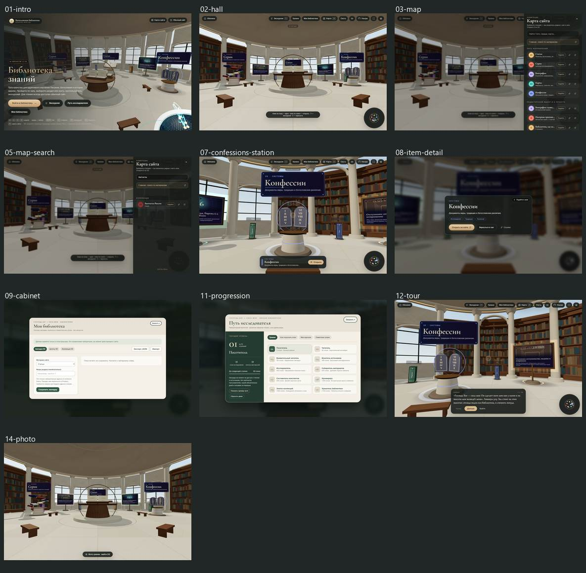
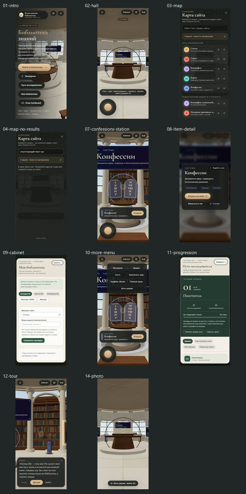
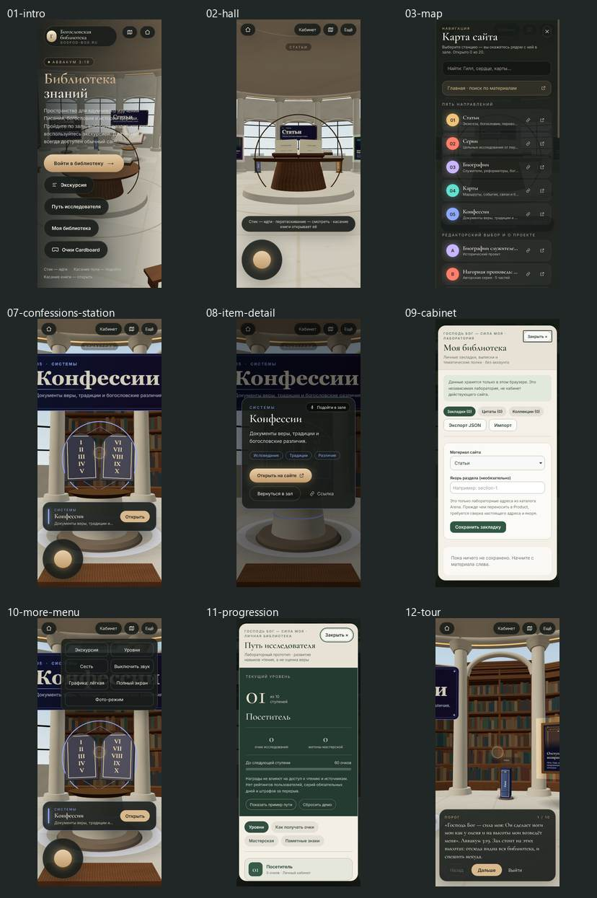
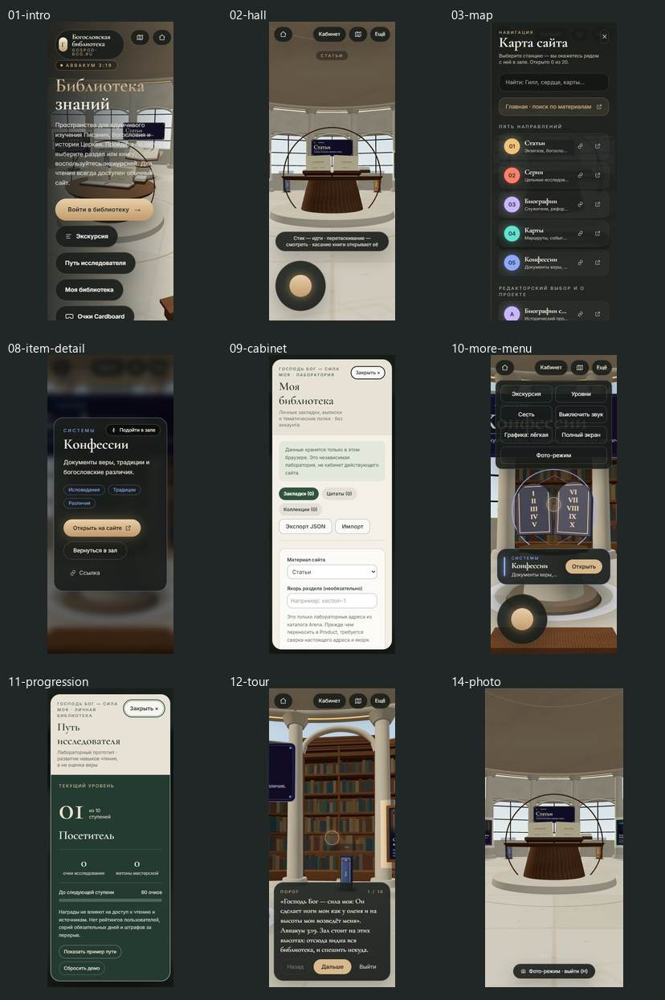

# Premium 3D Library — контрольный аудит со скриншотами

| Параметр | Значение |
| --- | --- |
| Дата | 9 ноября 2026 |
| Репозиторий | AuditRepo / premium-3d-library |
| PR | [#545](https://github.com/FedorMilovanov/AuditRepo/pull/545) |
| Проверяемый HEAD | `c611a49c8764ead62652bdd58ba5f27f713eb503` |
**Состояние:** **LAB / DRAFT / ART HOLD** — не принятая версия, не Product, не публикация на действующем сайте.

## 1. Итоговое заключение

**Вердикт: лабораторная версия технически работоспособна, но НЕ ГОТОВА к выпуску.** Критическое препятствие обнаружено при настоящем мобильном сценарии в альбомной ориентации 844×390: кнопка входа находится за нижней границей экрана, прокрутки нет, обычный клик невозможен. Второе серьёзное препятствие — открытая карта сайта не удерживает клавиатурный фокус внутри себя, не имеет `role="dialog"` и не переводит фокус на содержимое.

Фотореалистичность всё ещё существенно ниже утверждённого архитектурного ориентира. Увеличивать число прорисованных пролётов без художественной приёмки и бюджета производительности нельзя.

**Положительные результаты:** GitHub CI 2/2 SUCCESS на точном HEAD; лабораторные проверки/TypeScript/build PASS; 75 подтверждённых браузерных кадров; восстановление имитированного WebGL-контекста 2/2; отдельный fallback без WebGL существует и предлагает обычную библиотеку. Зафиксировано отсутствие JS pageerror и HTTP 4xx/5xx в пройденных штатных сценариях. Это не является доказательством полноценного мобильного/VR-релиза.

## 2. Среда и методика

| Параметр | Фактическая проверка |
| --- | --- |
| Код | HEAD `c611a49`, рабочая копия с `git status` без модификации отслеживаемых файлов |
| Windows | DESKTOP-O3FDOA4, Windows 11, NVIDIA RTX 3060 12 ГБ |
| Браузеры | установленный Chrome через Playwright Chromium channel; Playwright WebKit на Windows |
| Разрешения | 1440×900, 390×844, 320×760, 844×390 |
| Эмуляция | 390/320/844 мобильные viewport + touch, но **настольная GPU** |
| Пользовательские шаги | обложка → вход → зал → карта/поиск → станция → карточка → кабинет → уровни → экскурсия → фото |
| Дополнительно | клавиатурный Tab/Escape, экран без WebGL, имитация потери/возврата WebGL-контекста |
| Скриншоты | **75 первичных снимков**, из них отобрано 28 полноразмерных и 4 контактных листа |
| Формат доказательств | полноразмерные **lossless WebP** с точным совпадением декодированных RGB-пикселей и SHA-256 в [manifest.json](evidence/audit-v57/manifest.json) |

Важно: тестовый `Screenshot PASS` доказывает получение кадра и отсутствие зарегистрированного исключения, **но не означает художественного или WCAG PASS**. Основной визуальный аудит выполнен непосредственной оценкой кадров, DOM-геометрии и проверки клавиатурных переходов. Настоящие iPhone/Android/Quest/Pico, FPS GPU, термальное троттлирование и автономная сеть не проверялись.

### Матрица покрытия

| Конфигурация | Снимки | Результат основного пути |
| --- | ---: | --- |
| Chrome 1440×900 | 14 | штатные состояния достигнуты |
| Chrome touch 390×844 | 15 | штатные состояния достигнуты |
| Chrome touch 320×760 | 15 | штатные состояния достигнуты |
| Chrome touch 844×390, альбомная | 2 | **FAIL: кнопка входа за экраном** |
| WebKit 1440×900 | 14 | штатные состояния достигнуты |
| WebKit touch 390×844 | 15 | штатные состояния достигнуты после корректного ожидания монтирования интерфейса |
| **Итого** | **75** | **5 пройденных пользовательских цепочек; 1 заблокированная** |

## 3. Главные находки и серьёзность

### A-01 — BLOCKER / P0. Вход заблокирован в альбомной ориентации

**Доказательство:** [скриншот 844×390](evidence/audit-v57/21-mobile-landscape-844x390-blocked-entry.webp).

В Chrome mobile touch 844×390 верх кнопки `Войти в библиотеку` имеет `y = 393.03 px`, низ `449.03 px` при высоте viewport `390 px`. Элемент физически за границей экрана. `documentElement.scrollHeight = 390`, прокрутки нет. Стандартный Playwright click воспроизводимо завершается `element is outside of the viewport`. Кнопки экскурсии, уровней, кабинета и Cardboard находятся ещё ниже.

**Системная причина:** обложка размещена в фиксированной области `inset-0` внутри `overflow-hidden`, без компактного режима для малой высоты.

**Правильное исправление:** общий адаптивный shell обложки с `min-height` / внутренней вертикальной прокруткой и компактными отступами при ограниченной высоте, с тестами 667×375, 736×414, 844×390, 932×430, а не условное перемещение одной кнопки. Gate: вход, экскурсия и обычный сайт доступны **настоящим касанием** без JS-инъекций.

### A-02 — HIGH / P1. Карта сайта нарушает модальность и управление фокусом

**Доказательство:** [карта сайта на десктопе](evidence/audit-v57/03-desktop-sitemap.webp), [карта на мобильном](evidence/audit-v57/12-mobile-390-sitemap.webp), протокол Tab из отдельного воспроизводимого браузерного испытания.

После открытия карты `document.activeElement` остаётся `BODY`; диалогов `[role="dialog"]` в DOM нет. Первые **10 нажатий Tab** перемещают фокус по видимым и скрытым за затемнением действиям основного HUD: Обложка, Экскурсия, Уровни, Кабинет, Карта, Сесть, Звук, Качество, Полный экран, Фото. Лишь затем управление переходит в `aside` карты. Кнопка закрытия — голый SVG без `aria-label`. У поискового поля нет связанного `label` или `aria-label` (есть только placeholder).

`Escape` закрывает карту — этот путь работает, но не устраняет нарушение порядка фокуса.

**Правильное исправление:** единый примитив модального слоя, согласованный с кабинетом и уровнями: `role="dialog"`, `aria-modal`, именованный заголовок, перевод фокуса в карту при открытии, удержание Tab внутри, `inert`/блокировка фоновых контролов, восстановление исходного фокуса при закрытии и ясное имя кнопки. Не создавать второй независимый «движок» модальных окон.

### A-03 — HIGH / P1. Художественная цель не достигнута

**Доказательство:** [весь зал, desktop](evidence/audit-v57/02-desktop-hall.webp), [эталонный пролёт](evidence/audit-v57/04-desktop-confessions.webp), [мобильная перспектива](evidence/audit-v57/11-mobile-390-hall.webp), исходный концепт [reference/library-design-target.png](reference/library-design-target.png).

В реальном кадре видны повторяющиеся цветные прямоугольники книг, упрощённые профили мебели, чрезмерно светлый низ и очень заметные плакаты/светящиеся окружности. Поверхности и архитектурный ритм не воспринимаются как цельное премиальное помещение. V5.6 добавила объём в **один** пролёт, но не решила качество всего зала.

**Правильное решение:** художественно согласованный набор 3D-ассетов (архитектурная GLB-система, полки, качественные UV/PBR/roughness, освещение без выжженных поверхностей и единая типографика интерактивных элементов); сравнить при **одинаковых камерах**, сделать approval на одном пролёте, только потом масштабировать. Не заменять дизайнерскую работу сотнями случайных procedural meshes.

### A-04 — HIGH / P1. WebKit desktop не выполняет желаемую плавность

**Доказательства:** `tests/render-performance-browser.py` и V5.6 инженерный протокол. На той же машине/при 1× DPR: Chrome 1440×900 — **247.2 draw calls/кадр, 60 rAF/с**; Playwright WebKit 1440×900 — **248.5 draw calls/кадр, 28.5 rAF/с**, p95 ~43 мс. На эмулированном 390×844 — ~126.6 draw calls, около 60 rAF/с в обоих движках.

Это **не FPS физического iPhone** и не GPU frame time. Но настольный WebKit-путь явно существенно медленнее; выпуск без реальных Safari/iOS, GPU/VRAM-замеров и исследованной причины нельзя считать подготовленным.

### A-05 — HIGH / P1. Контент и пользовательский кабинет остаются лабораторными

**Доказательство:** [кабинет](evidence/audit-v57/06-desktop-cabinet.webp), [прогресс](evidence/audit-v57/07-desktop-progression.webp), источник `src/data.ts` и `QA_V5_REAL_BROWSER.md`.

Карты/серии/тексты зала используют демонстрационный каталог `ITEMS`. Путь уровней и личные данные живут в отдельном локальном лабораторном хранилище; это **не** текущий Product `GBReaderLibrary V3`, без подтверждённой связки с редакторскими маршрутами, правами, индексируемостью и актуальными публикациями. Технический smoke здесь не гарантирует корректные ссылки на живом сайте.

**Gate:** источник истины Product → валидированный manifest/adapter → проверка routes, noindex, content rights → раздельная миграция данных и политик приватности. До тех пор лабораторную функциональность нельзя рекламировать как готовый кабинет.

### A-06 — MEDIUM / P2. Мобильная композиция плохо использует экран

**Доказательство:** [320×760, обложка](evidence/audit-v57/19-mobile-320-cover.webp), [320×760, зал](evidence/audit-v57/20-mobile-320-hall.webp), [390×844, зал](evidence/audit-v57/11-mobile-390-hall.webp).

На узких экранах заметная часть кадра занята пустым потолком, центральный объект мал. Текст вводной обложки местами накладывается на довольно контрастные фоновые объекты. Это не горизонтальный overflow и не падение движка, но уменьшает визуальную ценность, читабельность и ощущение «премиальности». Требуется нормальный мобильный camera composition preset / обзор с сохранением маршрутов и безопасной зоны интерфейса, а не глобальный `zoom` через CSS.

### A-07 — MEDIUM / P2. Фото-режим показывает непрозрачный переход

**Доказательство:** [устоявшийся фото-режим desktop](evidence/audit-v57/09-desktop-photo-settled.webp), [устоявшийся мобильный](evidence/audit-v57/18-mobile-390-photo-settled.webp).

При проверке через **100 мс** после открытия фото-режима экран однородный `RGB 196,193,183` (стандартная fade-вуаль). Примерно через **650 мс** текстуры и сцена снова видимы; состояние устойчивое, не бессрочное зависание. Это **не** ошибка чёрного экрана. Визуально, однако, непрозрачная вспышка в premium-сцене выглядит грубо. Можно заменить на более мягкую / сокращённую непрерывную смену, только если не появятся tearing, мигание шейдеров или потеря позы камеры.

### A-08 — MEDIUM / P2. Тесты были недостаточны для UI-приёмки

До этого прогона автоматизация акцентировала `WebGL2`, загрузку ресурсов, отсутствие HTTP/JS ошибок и несколько портретных ширин. Проверка **реального клика по CTA в альбомной ориентации**, modal focus trap и подписи иконок отсутствовала — именно поэтому A-01 и A-02 прошли через CI.

Требуется обязательный gate `browser-journey`: два движка, портрет + альбомная, обложка→вход, map/focus, tour, detail, cabinet, empty state, loss/recovery. Тесты могут пропускать только неподдерживаемые платформой сценарии с честным `SKIP`, а не бессодержательным `PASS`.

### A-09 — MEDIUM / P2. Тяжёлый основной JS, хотя XR-чанки отложены

Основной Vite JS ~**1,466 КБ minified** (~**414 КБ gzip**). На стабильной лабораторной загрузке Chrome передано около **2.88 МБ ресурсов**. Большие `music_room` / `living_room` / XR-`emulate` чанки собираются, но **не** загружаются автоматически при обычном входе — не следует записывать их в cold-start 3D-зала. Следующий gate — анализ coverage для реально используемого кода, first interaction и long tasks, а не искусственное дробление чанков.

### A-10 — PASS / полезные механизмы отказоустойчивости

- [Экран без WebGL](evidence/audit-v57/28-no-webgl-fallback.webp): при запрете WebGL показан осмысленный fallback `Зал закрыт на ремонт`, кнопки «Моя библиотека · без 3D», «Обновить страницу» и ссылка на обычную библиотеку.
- [Потеря WebGL-контекста](evidence/audit-v57/26-webgl-context-lost.webp) → [восстановление](evidence/audit-v57/27-webgl-context-restored.webp): в Chromium desktop и WebKit touch, **2/2**, временный экран восстановления появляется и затем исчезает, JS pageerror отсутствуют.
- Основные модали кабинета и уровней имеют `role="dialog"` / `aria-modal`, начальный фокус на кнопке закрытия и выход по Escape.
- 320/390 portrait: в наблюдаемых сценариях нет document horizontal overflow; мобильная компактная навигация и джойстик присутствуют; существующие проверки перекрытий прошли.
- WebKit стартовый пустой снимок в первом автоматическом прогоне оказался **гонкой теста до монтирования React**, а не зависшим UI. Повтор после появления CTA даёт нормальный кадр: [устоявшаяся обложка WebKit](evidence/audit-v57/22-webkit-mobile-cover-settled.webp).

## 4. Снимки — обзорные листы

Это **реальные браузерные скриншоты**, а не изображения, созданные нейросетью. Монтажи уменьшены только для удобства просмотра; полноразмерные кадры размещены рядом.

### Десктоп, Chrome 1440×900

### Мобильный Chrome, 390×844

### Мобильный WebKit, 390×844

### Узкий экран, Chrome 320×760

**Особо важные отдельные снимки:** [заблокированный альбомный вход 844×390](evidence/audit-v57/21-mobile-landscape-844x390-blocked-entry.webp), [стартовый зал](evidence/audit-v57/02-desktop-hall.webp), [карта desktop](evidence/audit-v57/03-desktop-sitemap.webp), [карта mobile](evidence/audit-v57/12-mobile-390-sitemap.webp), [мобильный экран кабинета](evidence/audit-v57/14-mobile-390-cabinet.webp), [путь исследователя](evidence/audit-v57/16-mobile-390-progression.webp), [детальная карточка](evidence/audit-v57/13-mobile-390-detail.webp).

## 5. Приоритеты устранения — без костылей

| Волна | Требуемая инженерная приёмка | Статус |
| --- | --- | --- |
| **P0 / Responsive Shell** | Вход на всех ориентациях, нормальная вертикальная прокрутка низкого экрана; реальные tap-тесты | **FAIL** |
| **P1 / Shared Modal Contract** | Карта, кабинет, уровни используют единые правила `dialog`, focus trap/restore, Escape, inert background, labels | **FAIL для карты** |
| **P1 / Art Direction** | Эталонный GLB-пролёт с корректными UV/PBR/светом; парные кадры, owner approval | **HOLD** |
| **P1 / Performance** | Real Safari/iPhone, Android low-tier, GPU frame-time, VRAM, context cycles, VR | **HOLD** |
| **P1 / Product Boundary** | Актуальный Content Registry, права, noindex, Reader/cabinet source alignment | **HOLD** |
| **P2 / Mobile camera** | Правильная композиция при 320/390, без визуальной деградации и перекрытий | **OPEN** |
| **P2 / Transitions** | Убрать лишнюю непрозрачную вспышку, сохранив lifecycle безопасности сцены | **OPEN** |
| **P2 / QA** | Зафиксировать проверенные скриншоты и контрольные формальные пути в CI | **OPEN** |

## 6. Жёсткие условия выпуска

- [ ] Нет заблокированного входа на экранах 320×568, 390×844, 667×375, 736×414, 844×390, 932×430, 768×1024, 1440×900.
- [ ] Клавиатура и screen reader могут работать с картой и всеми модальными слоями, не проваливаясь в фон.
- [ ] Параллельная визуальная приёмка **утверждённого** архитектурного референса на реальных кадрах, а не по концепт-арту.
- [ ] Реальный мобильный Safari, Android среднего/слабого класса и VR — с GPU/memory/thermal instrumentation.
- [ ] Измерены сетевые бюджеты, cold-start, качество/устойчивость при переключении режимов.
- [ ] Источники, ссылки, цитаты, права и публичные маршруты сверены с Product.
- [ ] Точный релизный коммит проверен терминальным CI и отдельной production-превью, без замещения успешного статуса не относящимися к делу smoke-тестами.
- [ ] Только затем отдельное решение о merge и публикации.

## 7. Границы и доказательность

Этот аудит **не** меняет код 3D-движка, каталог, Production, `main` или права доступа. Текущие дефекты зарегистрированы, а не автоматически «объявлены исправленными».

Полный набор [evidence/audit-v57](evidence/audit-v57/) содержит 28 оригинальных по пикселям WebP-снимков, четыре индексных контактных листа и SHA-256-реестр. Параметры точного кандидата вынесены в `manifest.json`. Исторические свидетельства V5.2/V5.6 не перезаписывались.

**Вывод:** текущий 3D-прототип пригоден для дальнейшей контролируемой разработки, **но не готов к приёмке как премиальная библиотека и не готов к публикации**.
